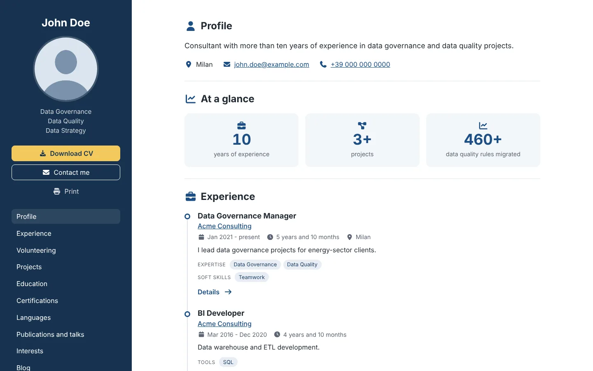
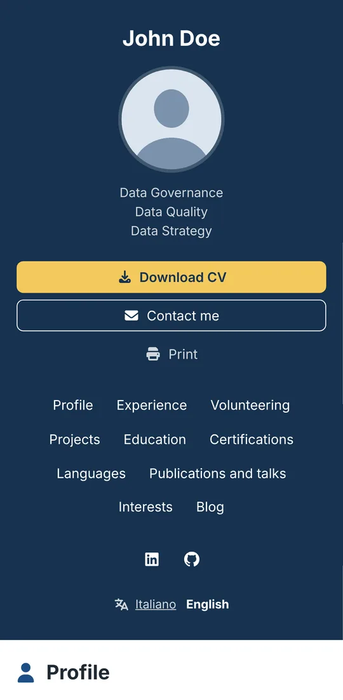
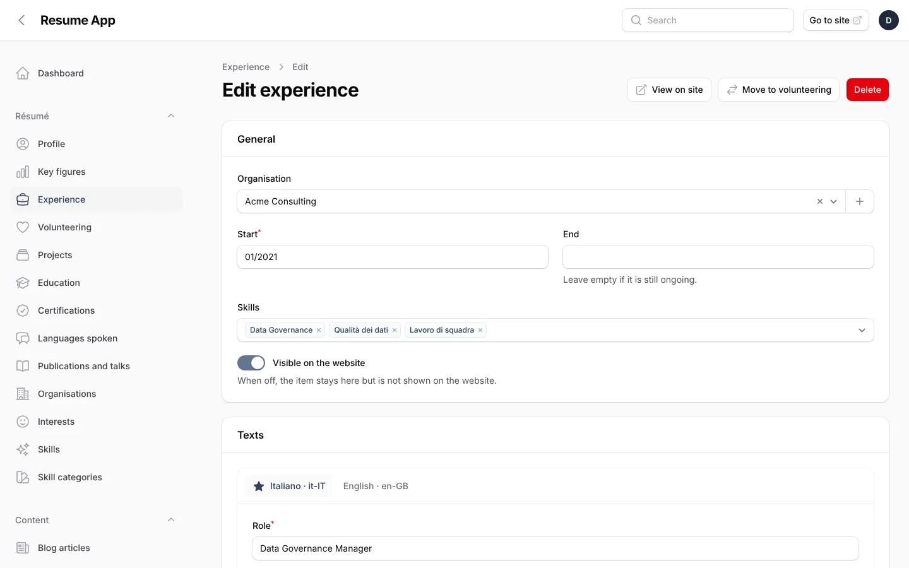
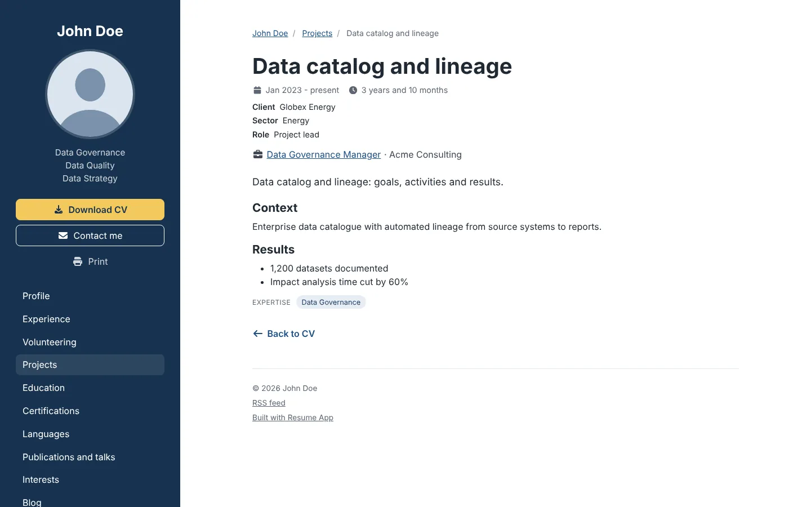

# 📋 Resume App - multilingual CV website with an admin panel

[](https://github.com/Razzo1987/Resume-Application/releases/latest)
[](https://github.com/Razzo1987/Resume-Application/actions/workflows/ci.yml)
[](https://github.com/Razzo1987/Resume-Application/actions/workflows/release.yml)
[](https://php.net/)
[](https://laravel.com/)
[](https://filamentphp.com/)
[](https://mysql.com/)
[](LICENSE)

> A professional, multilingual CV / résumé website that you manage entirely from the browser.
> Upload one zip to ordinary shared hosting (cPanel works fine), run the web installer, fill in your CV in the admin
> panel and keep it up to date with one click. The public site sets **no cookies** and loads **nothing from third
> parties**: fonts, icons, scripts and styles are all self-hosted.

<p align="center">
  
  
</p>

[](https://codespaces.new/Razzo1987/Resume-Application?quickstart=1)

Version 2 is a complete rewrite of Resume Application 1.x on **Laravel 13** and **Filament 5**. Content from version 1
can be imported (see [docs/INSTALL.md](docs/INSTALL.md#from-version-1)).

## 📑 Table of Contents

- [✨ Features](#-features)
- [📸 Screenshots](#-screenshots)
- [🧪 Try it in your browser](#-try-it-in-your-browser)
- [🛠️ Technical Stack](#️-technical-stack)
- [📋 Requirements](#-requirements)
- [🚀 Installation](#-installation)
- [⚙️ Configuration](#️-configuration)
- [🔄 Updating](#-updating)
- [🎨 Themes](#-themes)
- [🧑‍💻 Development](#-development)
- [📁 Project Structure](#-project-structure)
- [🤝 Contributing](#-contributing)
- [📄 License](#-license)
- [👨‍💻 Author](#-author)
- [🆘 Support](#-support)

## ✨ Features

### 🌐 Public site
- **All the sections of a CV**: profile, key figures, work experience, volunteering, projects, education,
  certifications, languages spoken (CEFR levels), publications and talks, interests, latest blog articles. Each one
  can be enabled, hidden from the menu, renamed and reordered.
- **Detail pages** for projects, experiences and blog articles, only when there is something more to say than the
  CV summary (no empty pages for search engines).
- **Any number of languages** with translated URLs (`/it-IT/progetti/...`, `/en-GB/projects/...`) and a language
  switcher that keeps you on the same page. Language packs for it-IT, en-GB, en-US, de-DE, fr-FR, es-ES, pt-PT, pt-BR
  and nl-NL.
- **CV in PDF** for each language, versioned, downloaded with a clean file name (`CV Jane Doe - EN.pdf`).
- **Mini blog** with RSS feed per language and scheduled publishing.
- **Print-friendly** page and an optional "Print" button.

### 🔍 SEO, privacy and performance
- `canonical`, `hreflang` + `x-default`, Open Graph with a sharing image, sitemap with language alternates,
  Schema.org JSON-LD (`ProfilePage`, `Person`, publications, breadcrumbs, `BlogPosting`).
- Permanent redirects when a slug or a URL word changes, plus your own redirects for old addresses.
- **Privacy by default**: no cookies for visitors, no external requests, strict Content Security Policy; email and
  phone are encoded in the HTML; email, phone and birth date stay out of the structured data unless you enable them.
- HTML page cache cleared on every change, ETags, a reduced Bootstrap build and an SVG icon sprite with only the
  icons in use. Lighthouse 100 on the demo data, WCAG 2.1 AA checked with axe.

### 🛠️ Admin panel
- One form per item with a **tab for each language**; a *Translations* page lists what is still missing.
- Images resized and converted to WebP on upload; organisation logos, certification badges, project images.
- Key figures computed for you (years of experience, projects, certifications...) or written by hand.
- Two-factor authentication, configurable admin address, interface in Italian or English.
- **Content export and import** (zip) to back up the site or move it to another server.

### 📦 Installation and updates
- **Web installer**: requirements check, database, administrator, languages, HTTPS and "without www" redirects.
- **Updates from the admin**: new versions are announced from the GitHub releases; the package is downloaded
  straight to the server (or uploaded from your computer, with no upload-size limit), checked, installed in a few
  seconds and completed automatically. No FTP needed.

## 📸 Screenshots

| Admin panel | Project page |
|---|---|
|  |  |

More in **[docs/SCREENSHOTS.md](docs/SCREENSHOTS.md)**: CV, detail pages, blog, phone layout and the admin pages.

## 🧪 Try it in your browser

Click **Open in GitHub Codespaces** above (a free GitHub account is enough): in a couple of minutes you get your own
copy running with the sample CV of "John Doe".

- **Site**: *Ports* tab → port 8000 → open in the browser;
- **Admin**: the same address followed by `/admin`, user `demo@example.com`, password `demo-password`.

Everything stays inside your Codespace (delete it when you are done). The configuration is in
[`.devcontainer`](.devcontainer).

## 🛠️ Technical Stack

| Component | Technology |
|-----------|------------|
| **Backend** | PHP 8.4 / 8.5, Laravel 13 |
| **Admin panel** | Filament 5 (Livewire 4) |
| **Database** | MySQL 8.0+ or MariaDB 10.11+ |
| **Frontend** | Blade themes, Bootstrap 5.3 (SCSS), vanilla JavaScript, Vite, Font Awesome icons as SVG sprite |
| **Quality** | Pest, Larastan (level 6), Pint, Playwright + axe (Chromium, Firefox, WebKit, mobile) |
| **Deployment** | Single zip for shared hosting, GitHub Actions for CI and releases |

## 📋 Requirements

-  **PHP 8.4 or 8.5** with `ctype`, `dom`,
  `fileinfo`, `filter`, `gd`, `intl`, `mbstring`, `openssl`, `pdo_mysql`, `session`, `tokenizer`, `zip`
-  **MySQL 8.0+** or MariaDB 10.11+
- **Apache** with `mod_rewrite` and `.htaccess` files enabled (standard on cPanel hosting)

No Composer, Node.js or command line is needed on the server: the release zip contains everything.

## 🚀 Installation

1. Download `resume-app-x.y.z.zip` from the [latest release](https://github.com/Razzo1987/Resume-Application/releases/latest).
2. Create a MySQL database and a user (cPanel → *MySQL Databases*).
3. Upload the zip to your web root (e.g. `public_html`) and extract it there.
4. Open `https://your-domain/install` and follow the installer.
5. Log in to the admin area and fill in your CV.

🎉 **That's it!** The full step-by-step guide, with the safety checks and troubleshooting, is in
**[docs/INSTALL.md](docs/INSTALL.md)**.

> 💡 **Want to try it first?** The installer can load a sample CV ("John Doe", Italian and English) that you can
> edit or delete later.

## ⚙️ Configuration

Almost everything is configured from the admin panel: profile and CV content, sections and their order, languages
and URL words, SEO, privacy options, CV file names, themes. A few server-level options live in `core/.env` (admin
address and language, update channel, mail).

📖 See **[docs/CONFIGURATION.md](docs/CONFIGURATION.md)** for a tour of the admin panel and the full list of settings.

## 🔄 Updating

From version 2.0.3 the site updates itself from the admin: *System* → *Updates*.

1. The dashboard tells you when a new version is published on GitHub.
2. **Download and install** fetches the package to the server and checks its SHA-256 (or upload a zip from your
   computer).
3. **Update now**: content backup, maintenance, files replaced in a few seconds (visitors see a "Site being updated"
   page), database and caches updated, maintenance off.

Updating by hand (extract the zip over the previous version, then *Complete the update*) still works. Details in
[docs/INSTALL.md](docs/INSTALL.md#updating).

## 🎨 Themes

The open **`base`** theme is included: two columns, Bootstrap 5, Font Awesome Free icons, light and fast.
Other themes extend it and only override what they change (a single view, colours, fonts, icons). They are
installed and updated from the admin (*Themes* → *Install or update a theme*) as a zip.

Icons are **semantic names** (`briefcase`, `cycling`, `energy`...) that each theme maps to its own icon set; the
names you can choose for interests and key figures are listed in
[docs/CONFIGURATION.md](docs/CONFIGURATION.md#icons).

Building your own theme: keep it in its own folder or repository (only `base` lives here) and build it with

```bash
scripts/build-theme.sh ../my-themes/fancy --zip ../dist   # copy, icon sprite, assets, installable zip
E2E_THEME=fancy npx playwright test                       # end-to-end suite with that theme active
```

## 🧑‍💻 Development

```bash
git clone https://github.com/Razzo1987/Resume-Application.git
cd Resume-Application
composer install
cp .env.example .env && php artisan key:generate
php artisan migrate --seed                 # default languages, CV sections, key figures
php artisan db:seed --class=DemoSeeder     # optional: sample CV of "John Doe" (it-IT / en-GB)
npm install && npm run build
php artisan make:filament-user             # first administrator
php artisan serve                          # http://localhost:8000 - admin at /admin
```

Quality checks (they run in GitHub Actions on every push; each run also keeps the Playwright report and the
screenshots of [docs/SCREENSHOTS.md](docs/SCREENSHOTS.md) as downloadable artifacts):

```bash
php artisan test                    # Pest (MySQL test database "resume_app_test")
vendor/bin/phpstan analyse          # Larastan
vendor/bin/pint --test              # code style
npx playwright test                 # end-to-end + accessibility (needs the demo data and built assets)
```

Release package: `scripts/build-release.sh` builds `resume-app-<version>.zip` (the GitHub *Release* workflow does
the same when a `v*` tag is pushed and publishes it with its SHA-256 and the changelog entry).

## 📁 Project Structure

```
Resume-Application/
├── 📁 app/
│   ├── 📁 Models/              # CV content; translated fields are JSON columns
│   ├── 📁 Filament/            # Admin panel: resources, pages, widgets
│   ├── 📁 Site/                # Public site: URLs, page metadata, JSON-LD, page cache
│   ├── 📁 Support/             # Languages, settings, installer, system tools, updates
│   └── 📁 Themes/              # Theme manager, installer, version constraints
├── 📁 themes/base/             # Open theme: views, icon map, SCSS and JS sources
├── 📁 lang/{code}/             # Language packs: routes.php (URL words), site.php (site texts)
├── 📁 resources/update/        # Update script that runs before Laravel while files are replaced
├── 📁 routes/site.php          # Public routes: no session, no CSRF, no cookies
├── 📁 stubs/                   # .htaccess blocks used by release packages
├── 📁 scripts/                 # build-release.sh, build-theme.sh, icon sprite builder
├── 📁 tests/                   # Pest tests and Playwright end-to-end tests (tests/e2e)
└── 📁 docs/                    # Installation and configuration guides
```

Release package layout, extracted inside the web root:

```
public_html/
├── index.php, build/, themes/   public files
├── uploads/                     uploaded images (never part of a package)
└── core/                        application code, denied to browsers by .htaccess
```

## 🤝 Contributing

Contributions are welcome!

1. **🍴 Fork** the repository
2. **🌿 Create** a feature branch (`git checkout -b feature/amazing-feature`)
3. **✨ Make** your changes and add tests
4. **🧪 Run** the quality checks above
5. **💾 Commit** your changes (`git commit -m 'Add some amazing feature'`)
6. **🚀 Push** the branch and open a pull request

A few rules keep the project what it is (more in [CLAUDE.md](CLAUDE.md)):

- no cookies on the public site and no external resources (fonts, scripts, styles, images);
- translatable content is stored once per item, with one JSON column per translated field;
- new site texts go in every language pack (`lang/{code}/site.php`, a test checks it);
- only the `base` theme lives in this repository.

## 📄 License

This project is licensed under the **MIT License** - see the [LICENSE](LICENSE) file for details.
Font Awesome Free icons: CC BY 4.0. Fonts used by the admin panel: SIL OFL 1.1.

## 👨‍💻 Author

### **Luca Racchetti**

[](https://luca.racchetti.org)
[](https://www.linkedin.com/in/razzo/)
[](https://github.com/Razzo1987)

*IT consultant in Data & AI Governance with a developer's background, who still enjoys building web applications.*

## 🆘 Support

### 🍺 Support the Project

If this project helped you, consider buying me a beer! 🍻

[](https://buymeacoffee.com/razzo)

### 💬 Get Help

- 🐛 **Found a bug?** [Open an issue](https://github.com/Razzo1987/Resume-Application/issues/new?template=bug_report.md)
- 💡 **Have a feature request?** [Open an issue](https://github.com/Razzo1987/Resume-Application/issues/new?template=feature_request.md)
- ❓ **Questions?** [Start a discussion](https://github.com/Razzo1987/Resume-Application/discussions)

---

**⭐ If this project helped you, please consider giving it a star! ⭐**

*Perfect for professionals who want a modern, fast and private CV website, with full control over their data and
presentation.*
