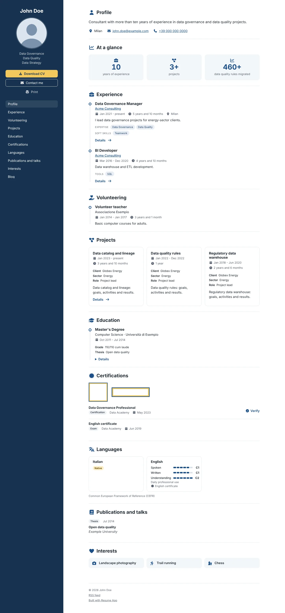
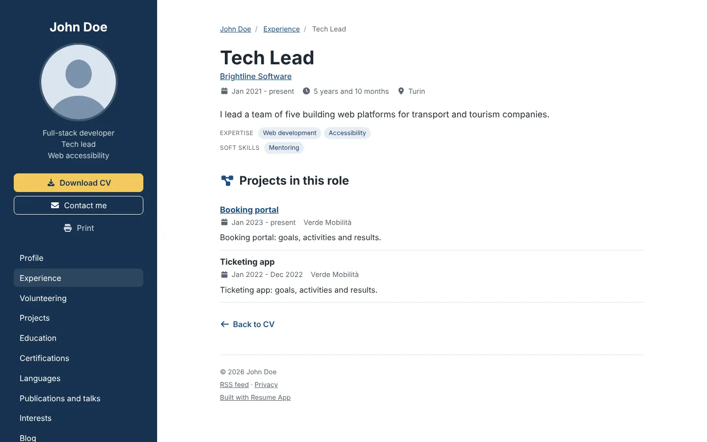
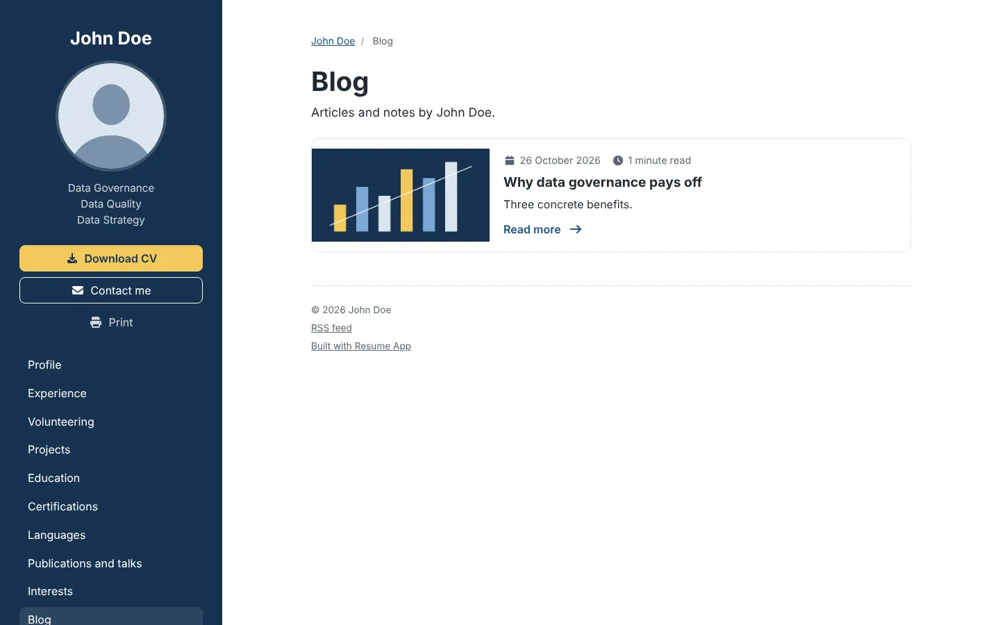
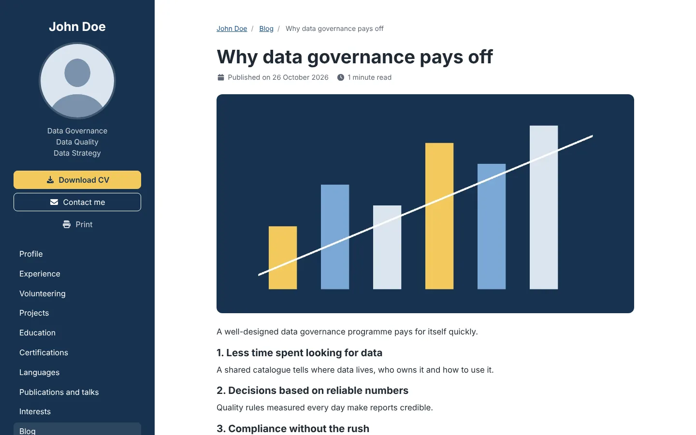
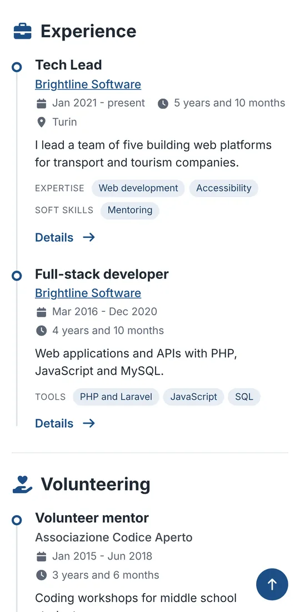
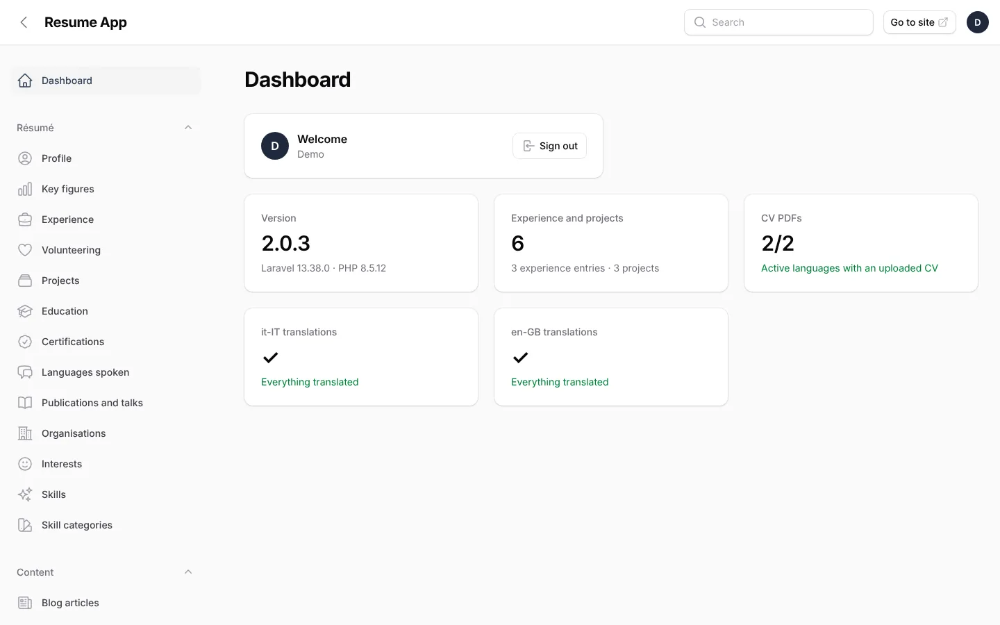
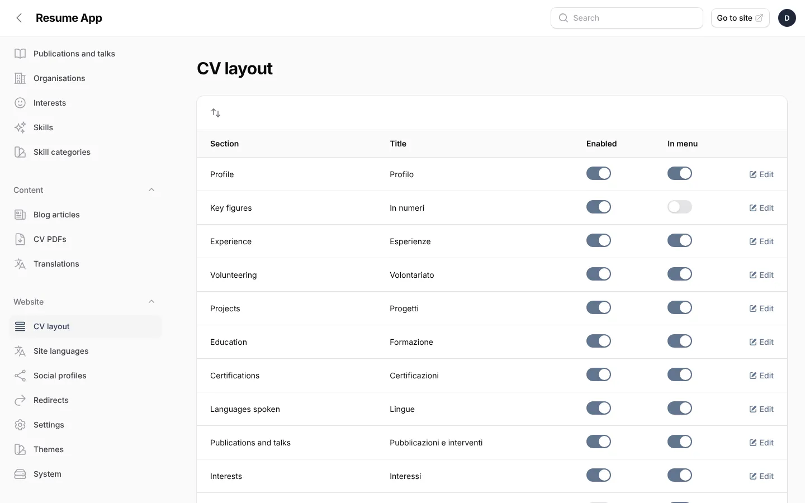
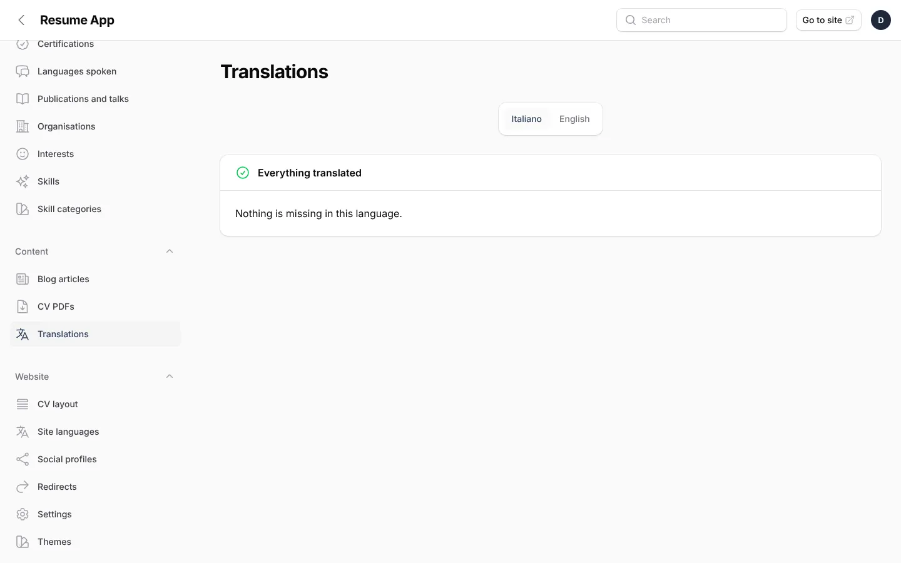
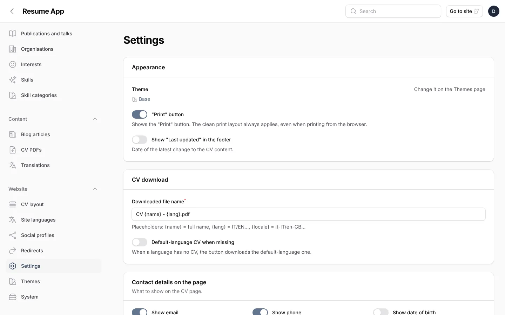
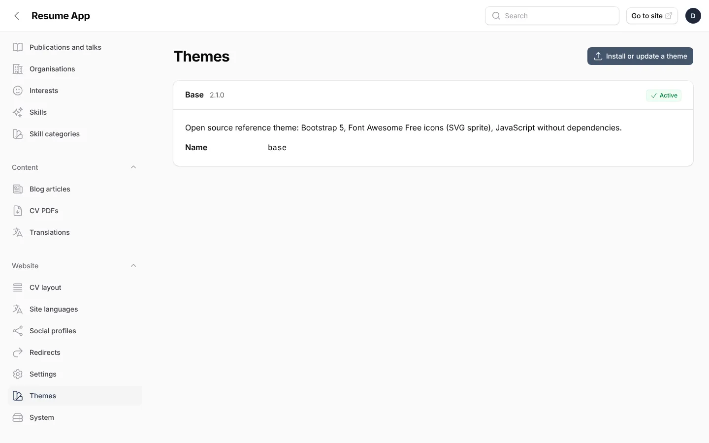

# Screenshots

Resume App with the open `base` theme and the sample CV of "John Doe" (the demo content you can load during the
installation). The images are taken by an end-to-end test (`tests/e2e/screenshots.spec.js`) on every push: the
latest ones are attached to the [CI workflow runs](https://github.com/Razzo1987/Resume-Application/actions/workflows/ci.yml)
as the `screenshots` artifact.

## Public site

| Desktop | Phone |
|---|---|
|  |  |

The CV page, top to bottom (click to open it full size):

<a href="screenshots/cv-full-page.webp"></a>

| Project page | Experience page |
|---|---|
|  |  |

| Blog | Article |
|---|---|
|  |  |



## Admin panel

| Dashboard | Editing an experience (one tab per language) |
|---|---|
|  |  |

| CV layout | Translations |
|---|---|
|  |  |

| Settings | Themes |
|---|---|
|  |  |

## Taking them again

```bash
php artisan migrate:fresh --seed && php artisan db:seed --class=DemoSeeder
php artisan make:filament-user --name=Demo --email=demo@example.com --password=demo-password
RESUME_ADMIN_LOCALE=en php artisan serve       # in another terminal
SCREENSHOTS=1 E2E_BASE_URL=http://localhost:8000 npx playwright test screenshots --project=chromium
```

The PNG files are written to `screenshots/`; the WebP versions in `docs/screenshots/` are smaller copies of them.
